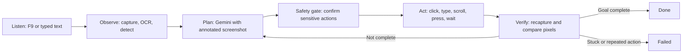

# Boot-to-Browser Autonomous Voice Co-Pilot

Boot-to-Browser is a voice-controlled desktop agent for visually impaired users. It listens for a goal, captures the real screen, grounds actions on numbered Set-of-Mark boxes, asks Gemini to select the next action, applies a confirmation safety gate, performs the action, and verifies the result.

## Architecture



The loop is implemented in `graph.py` using LangGraph. Shared Pydantic types are in `schema.py`. Vision modules capture the screen, run OCR/detection, and save numbered screenshots. Planning uses Gemini; actions use pyautogui or Playwright; safety and JSONL logging live under `safety/`.

## Windows setup

Python 3.11 is the target runtime.

```powershell
py -3.11 -m venv venv
.\venv\Scripts\Activate.ps1
python -m pip install --upgrade pip
pip install -r requirements.txt
python -m playwright install chromium
Copy-Item .env.example .env
```

Set `GEMINI_API_KEY` and `GEMINI_MODEL` in `.env`. See `.env.example`.

## Gemini API key

1. Create a Gemini API key in Google AI Studio.
2. Copy `.env.example` to `.env`.
3. Set `GEMINI_API_KEY` to the key and `GEMINI_MODEL` to a valid Gemini model name.
4. Optionally set `TTS_VOICE`; the default is `en-IN-NeerjaNeural`.

```dotenv
GEMINI_API_KEY=your_key_here
GEMINI_MODEL=your-gemini-model-name
TTS_VOICE=en-IN-NeerjaNeural
```

Never commit `.env` or log API keys. Passwords and OTPs are not sent to the cloud planner; the system prompt asks for `ask_user` instead.

## Download models

- Faster-Whisper loads the `base` model on first use with CPU and `int8` settings.
- Optional icon grounding uses `models/icon_detect.pt`. Add compatible YOLO weights to `models/`; otherwise OpenCV Canny contours are used.
- Piper fallback is available when a local `.onnx` voice model exists in `models/`.
- Edge TTS falls back to Piper, then `pyttsx3`, when internet or network synthesis is unavailable.

## Run the co-pilot

```powershell
python main.py
```

At startup the application plays a chime, opens Chromium to Google, says "Co-pilot ready", and waits for F9 push-to-talk. Say `exit` or `quit` to stop.

For testing without a microphone:

```powershell
python main.py --text "Open Google and search for today's weather"
```

## Run evaluation

The 12-task suite is in `eval/tasks.yaml`, and the local demo form is `eval/demo_form.html`.

```powershell
python eval/run_eval.py
```

After each click, enter `y`, `n`, or `s(skip)` in the terminal to record whether grounding was correct. Results are written to `eval/results.csv`.

## Evaluation results

| Metric | Result |
|---|---:|
| Tasks evaluated | `[PLACEHOLDER]` |
| Grounding accuracy | `[PLACEHOLDER]%` |
| Task completion rate | `[PLACEHOLDER]%` |
| Median latency per stage | `[PLACEHOLDER] ms` |
| P90 latency per stage | `[PLACEHOLDER] ms` |
| Median latency per task | `[PLACEHOLDER] ms` |
| P90 latency per task | `[PLACEHOLDER] ms` |

## Safety features

- Sensitive actions require explicit confirmation. Keywords include send, pay, payment, transfer, delete, remove, submit, confirm, purchase, buy, password, and OTP; `is_sensitive=true` also triggers confirmation.
- Confirmation accepts only a reply containing `yes` or `confirm`, with an eight-second timeout.
- Press `Ctrl+Shift+X` or say "stop" to abort active work immediately.
- Aborting stops queued speech and blocks subsequent desktop actions.
- The graph stops after 20 steps, two unchanged-screen retries, or three identical consecutive actions.

## Boot setup

Windows:

```powershell
powershell -ExecutionPolicy Bypass -File .\startup\install_windows.ps1
```

This registers `BootToBrowserCopilot` for log-on, waits 10 seconds, and configures restart on failure. Remove it with:

```powershell
powershell -ExecutionPolicy Bypass -File .\startup\uninstall_windows.ps1
```

Linux:

```bash
bash startup/install_linux.sh
```

True power-on behaviour requires OS auto-login and a graphical desktop session. Task Scheduler and systemd user services run after sign-in.

## Known Limitations

- Gemini is a cloud dependency; planning requires internet access and a valid API key.
- A complete loop step commonly takes about 4 to 8 seconds across capture, OCR/detection, cloud reasoning, action, and verification.
- Windows mixed-DPI monitors and scaling can affect screenshot coordinates despite DPI-awareness handling.
- OS auto-login is required for genuinely unattended power-on; startup tasks cannot create a desktop session before authentication.
- Annotated screenshots are sent to the Gemini cloud model. Avoid sensitive screens and never send passwords or OTPs to the cloud; users should consider the screenshot privacy boundary before use.
- OCR and icon detection depend on resolution, theme contrast, fonts, and availability of `models/icon_detect.pt`.
- The OpenCV fallback may detect decorative rectangles rather than clickable controls.
